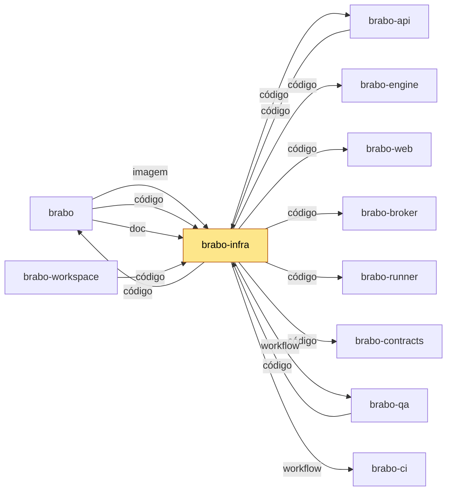

# brabo-infra

Sobe o Brabo: composes, Kubernetes, backup e restore, e as aferições que conferem os repositórios entre si.

## Para que existe

O Brabo é dividido em repositórios por camada (ADR 0252). Este guarda o que faz o produto rodar: os composes (dev, produção, instalação, observabilidade e GPU), os manifests de Kubernetes (`deploy/k8s`), o backup e o restore, o `docker-bake.hcl`, o `Makefile` e os scripts de ambiente (`scripts/dev`). Os Dockerfiles dos apps moram nos repositórios dos apps; o do backup fica aqui.

Este repositório não instala nem publica o produto. A porta de entrada do Brabo (documentação, `install.sh`, Release) é o [brabo](https://github.com/viralabs-dev/brabo).

## Onde se encaixa

<!-- mapa:inicio -->
<!-- Gerado do repos.yml do brabo por brabo-ci:scripts/ci/mapa-dos-repos.ts. Não edite à mão. -->

**brabo-infra** — Composes, Dockerfiles de integração, `deploy/k8s`, scripts de dev, release e cadeia de suprimentos. O brabo clona o brabo-infra no ref de `componentes.json` para subir a instalação; o brabo-api e o brabo-qa o clonam no CI.

| repo | propósito | como é usado | depende de | é usado por |
|---|---|---|---|---|
| brabo | Porta de entrada do produto — documentação agregada, site, instalador e release. | Quem instala usa o `install.sh` e as imagens e o binário das tags de `componentes.json`; o brabo-infra o clona nas aferições cruzadas. | brabo-api (imagem, doc), brabo-engine (imagem, doc), brabo-web (imagem, doc), brabo-broker (imagem, doc), brabo-runner (imagem, doc), brabo-infra (imagem, código, doc), brabo-contracts (doc), brabo-ci (doc, workflow), brabo-qa (doc) | brabo-ci (contrato), brabo-infra (código), brabo-workspace (código) |
| brabo-api | API do produto (NestJS, Drizzle, PostgreSQL/pgvector) — schema, RBAC, LLM, metering e gates. | Imagem publicada por tag e consumida pelo brabo e pelo brabo-infra; o brabo-web, o brabo-engine e o brabo-qa leem o código ou o `openapi.json` dele. | brabo-contracts (contrato), brabo-infra (código), brabo-qa (workflow), brabo-ci (workflow) | brabo (imagem, doc), brabo-engine (código), brabo-web (contrato), brabo-contracts (contrato), brabo-infra (código), brabo-qa (código), brabo-workspace (código) |
| brabo-engine | Engine (Elixir/OTP, Phoenix, Oban) — agentes, sessões, gates e roteamento de runners. | Imagem publicada por tag, usada pelo brabo e pelo brabo-infra. | brabo-contracts (contrato), brabo-api (código), brabo-runner (código), brabo-qa (workflow), brabo-ci (workflow) | brabo (imagem, doc), brabo-infra (código), brabo-qa (código), brabo-workspace (código) |
| brabo-web | Interface web (React 19, Vite) — telas, i18n e design system. | Imagem publicada por tag, usada pelo brabo e pelo brabo-infra. | brabo-contracts (contrato), brabo-api (contrato), brabo-qa (workflow), brabo-ci (workflow) | brabo (imagem, doc), brabo-infra (código), brabo-qa (código), brabo-workspace (código) |
| brabo-runner | CLI `brabo-runner` na máquina do usuário — PTY, container local e espelho. | Binário publicado por tag, instalado pelo brabo; o brabo-engine e o brabo-qa leem o código dele nos testes. | brabo-contracts (contrato), brabo-ci (workflow) | brabo (imagem, doc), brabo-engine (código), brabo-infra (código), brabo-qa (código), brabo-workspace (código) |
| brabo-broker | Único processo com o socket do Docker do servidor. | Imagem publicada por tag, usada pelo brabo e pelo brabo-infra. | brabo-contracts (contrato), brabo-qa (workflow), brabo-ci (workflow) | brabo (imagem, doc), brabo-infra (código), brabo-qa (código), brabo-workspace (código) |
| brabo-contracts | Contratos compartilhados — os pacotes `shared` e `docker-port`, `areas.json` e `fluxo.yml`. | Consumido por TAG (pacote no GitHub Packages ou arquivo baixado por raw na mesma tag); uma tag nova pede bump em api, web, runner, broker, engine, qa e infra. | brabo-api (contrato), brabo-ci (workflow) | brabo (doc), brabo-api (contrato), brabo-engine (contrato), brabo-web (contrato), brabo-runner (contrato), brabo-broker (contrato), brabo-infra (código), brabo-qa (contrato), brabo-workspace (código) |
| brabo-ci | Workflows reutilizáveis e a política de PR, escada de aprovação, promoção, tag e Dependabot. | Cada repo chama `uses: viralabs-dev/brabo-ci/...@<sha>`, fixado por SHA. | brabo-qa (contrato, workflow), brabo (contrato) | brabo (doc, workflow), brabo-api (workflow), brabo-engine (workflow), brabo-web (workflow), brabo-runner (workflow), brabo-broker (workflow), brabo-contracts (workflow), brabo-infra (workflow), brabo-qa (workflow), brabo-workspace (código, workflow) |
| **brabo-infra** | Composes, Dockerfiles de integração, `deploy/k8s`, scripts de dev, release e cadeia de suprimentos. | O brabo clona o brabo-infra no ref de `componentes.json` para subir a instalação; o brabo-api e o brabo-qa o clonam no CI. | brabo-api (código), brabo-engine (código), brabo-web (código), brabo-broker (código), brabo-runner (código), brabo-contracts (código), brabo (código), brabo-qa (workflow), brabo-ci (workflow) | brabo (imagem, código, doc), brabo-api (código), brabo-qa (código), brabo-workspace (código) |
| brabo-qa | E2E de navegador (Playwright), golden-sets e catálogo de funcionalidades — o portão da `main`. | O brabo-ci dispara o `e2e-pr` dele e lê o `funcionalidades.yml`; api, engine, web, broker e infra o chamam como portão. | brabo-api (código), brabo-engine (código), brabo-web (código), brabo-runner (código), brabo-broker (código), brabo-infra (código), brabo-contracts (contrato), brabo-ci (workflow) | brabo (doc), brabo-api (workflow), brabo-engine (workflow), brabo-web (workflow), brabo-broker (workflow), brabo-ci (contrato, workflow), brabo-infra (workflow), brabo-workspace (código) |
| brabo-workspace | Pasta-mãe `~/dev/brabo/` com os clones lado a lado e o `clonar-tudo.sh`. | Quem desenvolve roda `clonar-tudo.sh` uma vez; as sessões do Claude abrem nela. | brabo (código), brabo-api (código), brabo-engine (código), brabo-web (código), brabo-runner (código), brabo-broker (código), brabo-contracts (código), brabo-ci (código, workflow), brabo-infra (código), brabo-qa (código) | — |


<!-- mapa:fim -->

## Como é usado

O repositório não tem tag nem pacote de consumo: os composes sobem a partir dos clones irmãos, na mesma pasta-mãe. O [brabo-workspace](https://github.com/viralabs-dev/brabo-workspace) reúne os clones lado a lado:

```text
~/dev/brabo/
  brabo-infra/   <- você está aqui
  brabo-api/  brabo-engine/  brabo-web/  brabo-runner/  brabo-broker/  brabo-contracts/  brabo/
```

Com esses clones e o Docker instalado, um comando sobe o ambiente de dev:

```sh
make dev   # preflight (irmãos e pontos de montagem) + docker compose up
```

`BRABO_IRMAOS` muda a pasta-mãe (padrão `..` a partir deste repositório; nos composes, relativo a `docker/`, o padrão é `../..`).

## Como desenvolver

Pré-requisitos: Docker com `docker compose`, Node, pnpm (o `packageManager` do `package.json` fixa o pnpm 11.3.0) e os clones irmãos.

```sh
make dev                                             # preflight (irmãos + pontos de montagem) + compose up
docker compose -f docker/docker-compose.yml config   # resolve contextos e volumes
make k8s-validate                                    # kustomize + kubeconform nos overlays
pnpm install && pnpm typecheck && BRABO_IRMAOS=$HOME/dev/brabo pnpm test   # aferições (leem os irmãos)
```

Para `docker buildx bake` com os irmãos: `docker buildx bake --allow=fs.read=.. -f docker-bake.hcl`.

Subir os seis serviços a partir dos irmãos (`docker compose -f docker/docker-compose.yml up -d --wait`) é a prova da AT-707. A primeira rodada (05/11/2026, `make dev`) parou no broker; a correção (AT-737) já está na `dev` do `brabo-broker`, e a rodada com os seis serviços saudáveis ainda não foi registrada.

### Token do GitHub Packages

A api, a web e o broker instalam `@viralabs-dev/brabo-shared` e `@viralabs-dev/brabo-docker-port` (pacotes públicos, mas o registry pede token até para instalar). O token é um PAT classic só com `read:packages`, numa linha do `~/.npmrc` do host:

```text
//npm.pkg.github.com/:_authToken=<PAT>
```

- **Dev (`make dev`, `bootstrap.sh`)**: o compose monta o `~/.npmrc` como secret nos serviços que rodam `pnpm install` (`api`, `web`) e no build do `broker`. `NPMRC=<arquivo>` aponta para outro arquivo. O `bootstrap.sh` avisa, sem ecoar valor, se a linha não existe.
- **Build de imagem (bake, compose prod, `deploy/k8s/bootstrap.sh`)**: o mesmo arquivo entra como secret do BuildKit (`id=npmrc`), nunca como `ARG`/`ENV` nem em camada (RN-1039). Sem ele o build recusa.
- **CI**: o passo `.github/actions/npmrc` grava um `.npmrc` temporário com o `GITHUB_TOKEN` (job com `packages: read`) e exporta `NPMRC`.

## O que o CI garante

Só `pr-police` e `escada` (workflow `politica`) são exigidos pelo ruleset. Os demais checks são informativos e avisam antes do merge:

- **`Cadeia (actionlint e pins)`** (`ci.yml`): o actionlint dos workflows e a conferência de que cada `uses:` do `brabo-ci` está pinado por SHA, com o SHA da tag citada.
- **`Contracts alinhado`** (`ci.yml`): a versão do brabo-contracts é a mesma em todo lugar (RN-1038). A ref dele em `.github/actions/irmaos` é a `v1.2.0`.
- **`Typecheck e aferições (com os irmãos)`** (`ci.yml`): `pnpm typecheck` e `pnpm test` com os irmãos baixados na `dev` de cada repositório.
- **`Imagens lidas do compose`** (`ci.yml`): as imagens de terceiro (pgvector, ollama) saem do compose com digest.
- **`Composes resolvem`** (`ci.yml`): `docker compose config` dos composes, com os irmãos como contexto de build.
- **`Manifests de Kubernetes`** (`ci.yml`): `make k8s-validate`, as portas do overlay local e a regra de que `WEB_ORIGIN` deriva de `WEB_PORT`.
- **`Provas de propriedade`** (`propriedades.yml`, agendado e manual): as provas no k3d, o restore da instalação por compose e o restore em banco vazio.
- **`Dependências de merge`** (`dependencias.yml`): a PR declara o que espera com `Depende-de:`.
- **`Regressivo do brabo-qa`** (`qa-e2e.yml`): só atesta, nunca é exigido.
- **`readme-esqueleto` e `mapa-alinhado`** (`ci.yml`): o README segue o esqueleto e o bloco "Onde se encaixa" está em dia com o `repos.yml` do brabo.

## Documentação

- [`deploy/docs/runbook.md`](deploy/docs/runbook.md): operação, da triagem ao procedimento, passando por deploy local, backup e restore.
- [`deploy/docs/explanation/observability.md`](deploy/docs/explanation/observability.md): a observabilidade.
- [`deploy/docs/business-rules/infra.md`](deploy/docs/business-rules/infra.md): as regras de negócio desta área.
- [`CHANGELOG.md`](CHANGELOG.md) e [`CLAUDE.md`](CLAUDE.md): o histórico e as regras de quem muda este repositório.
- Página do produto: https://viralabs-dev.github.io/brabo/prd/.

## Como replicar no seu projeto

O que serve a outro projeto: o compose com contexto nos clones irmãos (`BRABO_IRMAOS`), o `docker-bake.hcl` com o token do registry como segredo do BuildKit, as aferições que leem os irmãos (`scripts/ci`) e o `Makefile` com `make dev` e o preflight. Copie o padrão e adapte nomes, portas e imagens ao seu produto.

O guia de adoção dos workflows está em [`adotar.md`](https://github.com/viralabs-dev/brabo-ci/blob/v1.4.0-dev.14/scripts/ci/docs/tutorials/adotar.md), no brabo-ci.

## Apoie

Se o projeto te ajuda, você pode [pagar um café no Ko-fi](https://ko-fi.com/daneiel).

## Licença

MIT. Veja o arquivo [LICENSE](LICENSE).
